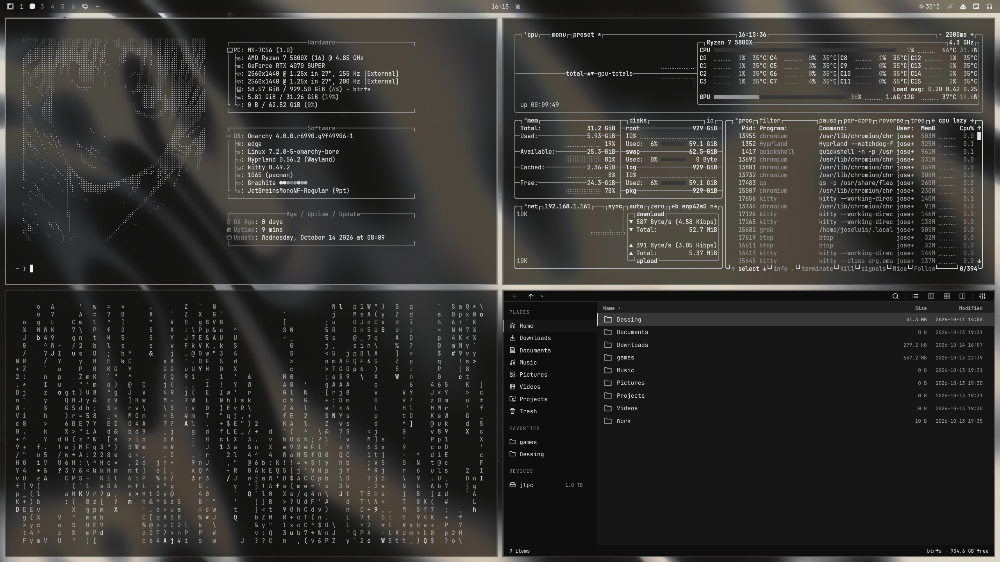

# Graphite

Tema oscuro monocromo para Omarchy. Grises de grafito, sin color de acento.



## Instalar

```bash
omarchy theme install https://github.com/joseluiss2003/omarchy-graphite-theme
```

También desde el menú de Omarchy: Install → Style → Theme, y pega la URL del repositorio.

```bash
omarchy theme set graphite
```

Al elegirlo, el fondo es `backgrounds/0-liquid-metal.jpg`. La intro `backgrounds/intros/0-liquid-metal.mp4` se reproduce en ese cambio. Los otros fondos siguen en el tema y se recorren con `omarchy theme bg next`.

## Iconos

`icons.theme` apunta a [YAMIS](https://github.com/googIyEYES/YAMIS) (Yet Another Monochrome Icon Set, GPL-3, de DIRN). Los SVG no van en este repositorio. El hook los descarga, pinta la tinta con el color de texto del tema activo y el resalte con el acento, y los instala en `~/.local/share/icons/YAMIS`.

Después de instalar el tema:

```bash
omarchy hook install theme-set ~/.config/omarchy/themes/graphite/hooks/30-yamis-recolor
~/.config/omarchy/hooks/theme-set.d/30-yamis-recolor
```

Eso también corre solo en cada `omarchy theme set`.
